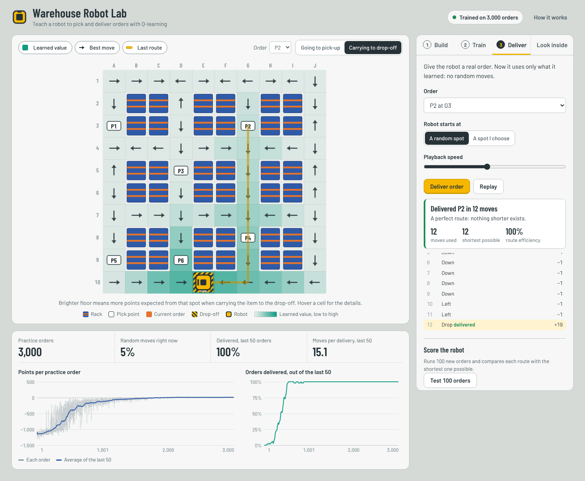

# Warehouse Robot Lab

A robot learns to pick up and deliver orders in a warehouse using **Q-learning**, a
basic reinforcement learning (RL) method. Nobody programs the route. The robot learns it
only from points it receives for each action.

You do everything in the browser: draw the warehouse, train the robot and watch it learn
live, send it on deliveries, and step through the learning formula one move at a time.



---

## What's in the project

| File | What it does | Lines |
|---|---|---|
| `environment.py` | The warehouse world: grid, racks, rewards, `reset()` and `step()` | ~200 |
| `agent.py` | The robot's brain: the Q-table and the Q-learning update | ~70 |
| `training.py` | The practice loop, the delivery replay and the 100-order test | ~80 |
| `app.py` | A small web server (FastAPI) connecting the page to the Python code | ~250 |
| `static/` | The web page: `index.html`, `style.css`, `app.js`, and fonts | |

The learning is plain Python with no NumPy or PyTorch. You only need **two packages**:
`fastapi` and `uvicorn`.

---

## How to run it (Windows, VS Code)

Open the terminal in VS Code with **Ctrl + `**. All commands below go in that terminal
(**Windows PowerShell**).

**Step 1: make sure VS Code has the right folder open.** It must be the folder that
directly contains `app.py`, for example `C:\Users\<you>\Downloads\warehouse-robot-lab`.
Windows "Extract All" often creates a folder *inside* a folder.

```powershell
Get-ChildItem          # you should see app.py, agent.py, environment.py, static ...
```

**Step 2: check Python** (3.9 or newer).

```powershell
python --version
```
If it isn't found, install Python from python.org and tick **"Add python.exe to PATH"**.

**Step 3: create a virtual environment and install the two packages.**

```powershell
python -m venv .venv
.\.venv\Scripts\Activate.ps1
pip install -r requirements.txt
```
If PowerShell says *"running scripts is disabled"*, run
`Set-ExecutionPolicy -Scope CurrentUser RemoteSigned` once, then activate again.

**Step 4: start the app.**

```powershell
python app.py
```
Open **http://localhost:8000** in your browser. Stop the server with **Ctrl + C**.

Optional: train without the web page, straight in the terminal:
```powershell
python training.py
```

<details>
<summary>Running on Linux (for example your RHEL VM) instead</summary>

**Linux terminal**
```bash
cd /root/warehouse-robot-lab
python3 -m venv /root/warehouse-robot-lab/.venv
source /root/warehouse-robot-lab/.venv/bin/activate
pip install -r requirements.txt
python app.py
```
</details>

---

## Using the app

1. **Build.** Pick a ready-made floor (Starter, Warehouse, Maze) or paint your own with
   racks, pick points and one drop-off. The checklist tells you if something is wrong.
2. **Train.** Set the learning settings, press **Start training**, and watch:
   * the floor turns teal where the robot expects more points;
   * arrows show its best move from every cell;
   * the charts show points per order rising and successful deliveries reaching 100%.

   Use **Watch each try** to see every single practice run. Early on the robot wanders
   around at random.
3. **Deliver.** Choose an order and a start cell, and watch the trained robot drive.
   **Test 100 orders** compares its routes with the shortest possible ones.
4. **Look inside.** Move one step at a time and see the Q-learning formula worked out
   with real numbers.

Hover over any cell to see the robot's six Q-values there.

---

## Reinforcement learning in 5 minutes

| RL word | In this project |
|---|---|
| **Agent** | the robot (`agent.py`) |
| **Environment** | the warehouse (`environment.py`) |
| **State** | where the robot is + which order + carrying or not |
| **Action** | Up, Down, Left, Right, Pick, Drop |
| **Reward** | −1 per move, −5 for hitting a rack, −10 for picking or dropping in the wrong place, +10 for picking up, +20 for delivering |
| **Episode** | one practice order, from a random start to delivery (or time-out) |
| **Policy** | the robot's strategy: in each state, pick the action with the highest Q-value |

### The Q-table

The robot's whole brain is one table, with one row per state and one column per action.
`Q[state][action]` means: *how many points do I expect from here on if I do this now?*
It starts full of zeros.

### The update rule (the heart of Q-learning)

After every action the robot updates **one** number:

```
new Q = old Q + α × (reward + γ × best next Q − old Q)
```

* **reward + γ × best next Q** is the *target*: what it just received plus the best it
  expects from where it landed.
* **target − old Q** is the *surprise* (called the TD error). If things went better than
  expected, Q goes up; if worse, it goes down.
* **α (learning rate)** controls how big each correction is.
* **γ (discount)** controls how much future points matter. At 0.95, the +20 delivery
  reward still counts from many steps away.

Repeat this thousands of times and the value of the drop-off spreads backwards across
the floor, one cell at a time. That spreading is exactly what the teal heatmap shows.

### Explore vs exploit (ε-greedy)

If the robot always picked its current best action, it would never discover better
routes. So with probability **ε** it picks a random action instead. ε starts at 1.0
(fully random) and falls to 0.05 as training goes on.

### Two details worth knowing for your viva

* **Ties are broken randomly.** At the start every Q is 0. Without random tie-breaking
  the robot would always choose "Up".
* **Time-outs are not endings.** If an episode stops because time ran out, the robot
  still uses `best next Q` in its update. Only a real delivery means "no future"
  (`done = True`). See `agent.learn()` and `training.train_one_episode()`.

---

## Experiments to try

Predict the result **before** you run each one.

1. Set **γ = 0.5** and retrain. What happens to the heatmap far from the goal? Does the robot still deliver?
2. Set **"Each move" = 0** in Reward rules. Do the routes stay short? Why or why not?
3. Set **ε start = 0.1**, so it explores very little. How does the success chart change?
4. Set **α = 1.0**. Then try **α = 0.01**.
5. Build a long maze. How many practice orders does it need now?

---

## Exercises: write these yourself

1. **SARSA.** Add a second agent where the target uses the action the robot *actually takes
   next* instead of the best one. Compare the two. (Search: "SARSA vs Q-learning cliff walking".)
2. **Battery.** Add a battery that drains by 1 per move, plus a charging cell. Running out
   gives −50. What must you add to the state?
3. **A moving obstacle.** Add a worker who walks randomly. Why does the Q-table approach
   start to struggle? (Count the states.)
4. **Save training charts.** Add a button that downloads the reward history as a CSV.

---

## Viva questions to practise

1. What is the difference between reinforcement learning and supervised learning?
2. What exactly is stored in the Q-table, and how many rows does the 10×10 warehouse need?
3. Walk through one Q-learning update with real numbers (use the Look inside tab).
4. Why does ε start high and end low?
5. What would happen with γ = 0? With γ = 1?
6. Why is there a −1 reward for every move?
7. Why must the state include "carrying or not"? What breaks without it?
8. How do you know the robot really learned and didn't just get lucky? (Hint: Test 100 orders.)
9. What are the limits of a Q-table? When would you need deep RL (DQN)?
10. How could this idea be used in a real warehouse?
